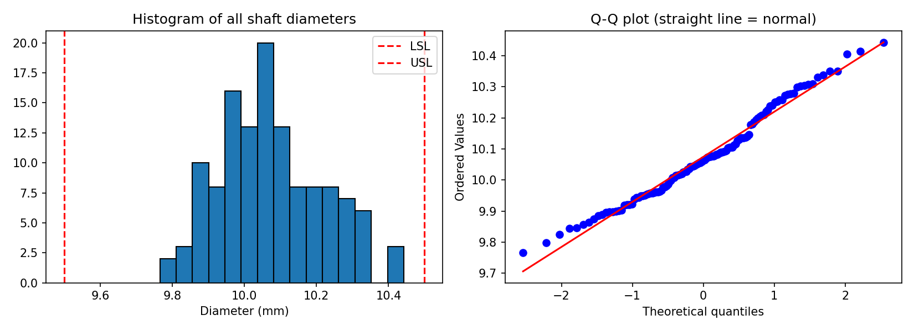
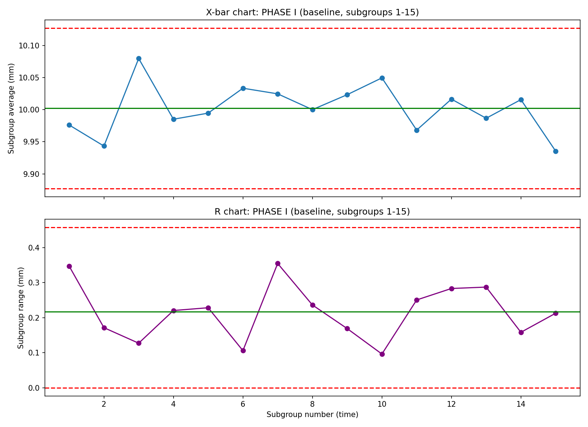
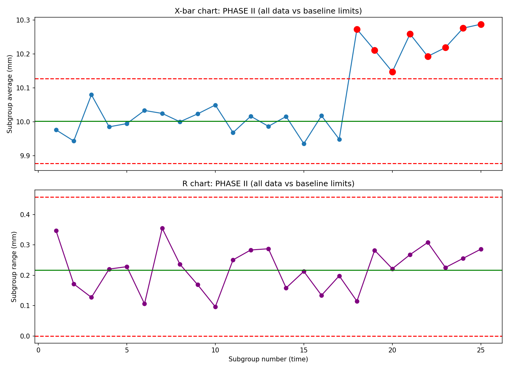
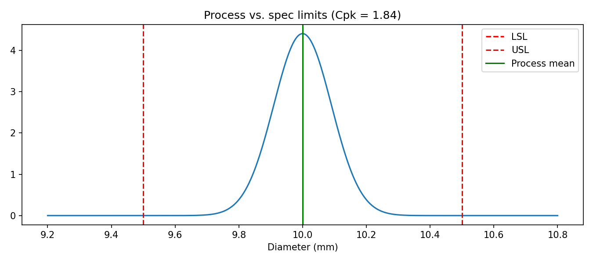

# Statistical Process Control: Control Charts and Process Capability Study

A Python project that answers two questions every manufacturing plant asks about a process:

1. **Is the process stable?** (control charts)
2. **Is the process capable?** (Cp, Cpk, Pp, Ppk, defect rate)

Built as an introduction to variation analysis, a core topic in industrial engineering and quality engineering.

## Problem

A factory machines metal shafts. The customer requires the diameter to be between **9.5 mm (LSL)** and **10.5 mm (USL)**. Every 5 shafts are measured per round (a *subgroup*), for 25 rounds.

The goals are to detect whether the process ever changes, and to determine whether it can reliably meet the customer's specification once stable.

> **Data note:** the data is simulated so the ground truth is known. The process runs at mean 10.0 mm with sigma 0.12 mm, and a mean shift to 10.25 mm is deliberately injected from subgroup 18 onward. This lets us check that the method actually catches a known problem. See [Limitations](#limitations).

## Approach

| Step | What | Why |
|---|---|---|
| 1 | Simulate 25 subgroups of n = 5 with a planted shift | Known ground truth to validate the chart |
| 2 | Histogram, Q-Q plot, Shapiro-Wilk test | Capability formulas assume roughly normal data |
| 3 | **Phase I:** build X-bar and R chart limits from the first 15 subgroups | Learn what "normal" looks like without contamination from the problem |
| 4 | **Phase II:** monitor all 25 subgroups against the fixed baseline limits | Detect changes |
| 5 | Signal rules: point beyond 3 sigma, 8 consecutive points on one side of the center line | Catch both sudden jumps and sustained shifts |
| 6 | Remove flagged subgroups (assumed assignable cause found and fixed) | Capability is only meaningful for a stable process |
| 7 | Compute Cp, Cpk, Pp, Ppk and estimated PPM | Translate variation into customer-relevant terms |

Control limits use standard SPC constants for n = 5 (A2 = 0.577, D3 = 0, D4 = 2.114, d2 = 2.326):

```
X-bar chart:  CL = grand mean,  UCL/LCL = grand mean ± A2 · R-bar
R chart:      CL = R-bar,       UCL = D4 · R-bar,  LCL = D3 · R-bar
sigma_within  = R-bar / d2
Cp  = (USL - LSL) / (6 · sigma)
Cpk = min(USL - mean, mean - LSL) / (3 · sigma)
```

Pp and Ppk use the overall sample standard deviation instead of `sigma_within`.

## Results

**Histogram and normality check**



**Phase I: baseline (subgroups 1 to 15) is stable, no signals**



**Phase II: all data against baseline limits. Subgroups 18 to 25 are flagged, matching the injected shift**



**Capability on the stable subgroups**

| Metric | Value |
|---|---|
| Mean | 10.000 mm |
| Sigma (within) | 0.091 |
| Sigma (overall) | 0.092 |
| Cp | 1.84 |
| Cpk | 1.84 |
| Pp | 1.80 |
| Ppk | 1.80 |



Full table: [`results/capability_summary.csv`](results/capability_summary.csv)

## Conclusion

- The X-bar chart detected the process shift starting at subgroup 18 (all 8 subgroups from 18 to 25 flagged, with no false alarms in the baseline). The R chart stayed in control, so the shift was in the process **center**, not its **spread**.
- After removing the shifted subgroups, the process is stable with **Cpk of about 1.84**, above the common 1.33 target, so it is **capable** and expected to produce very few defects.
- Cp and Cpk are nearly equal, so the stable process is well centered. A Pp/Ppk close to Cp/Cpk shows little drift between subgroups.
- **Recommendation:** in a real plant, investigate what changed at subgroup 18 (tool wear, new material lot, setup change) and add the 8-in-a-row rule to routine monitoring so a shift like this is caught within a few hours instead of after a full shift.

## Limitations

- **Simulated data.** Results show the method works, not how a real plant behaves. A natural extension is to run the same pipeline on a real dataset (for example UCI SECOM or a Kaggle manufacturing dataset).
- **Small sample (125 measurements).** The estimated sigma (0.091) came out lower than the true simulated value (0.12) purely by chance. Capability indices from small samples are noisy estimates; production studies typically use 100+ subgroups.
- **Capability is computed on the data left after removing flagged subgroups**, which assumes the root cause was found and eliminated. In real work that removal needs justification.
- **Normality is assumed** (Shapiro-Wilk p is about 0.05 on the full data, borderline because of the injected shift). For clearly non-normal data, a transformation or non-normal capability method would be needed.
- Only two run rules are implemented (3-sigma and 8-in-a-row). Nelson/Western Electric define more (trends, alternating points, 2 of 3 beyond 2 sigma).

## Repository structure

```
spc-capability-study/
├── README.md
├── LICENSE
├── requirements.txt
├── .gitignore
├── src/
│   └── spc_study.py          # full script, commented line by line
├── notebooks/
│   └── spc_study.ipynb       # same analysis as a step-by-step notebook
├── data/
│   └── simulated_shaft_data.csv
├── figures/                  # charts used in this README
└── results/
    └── capability_summary.csv
```

## How to run

```bash
git clone https://github.com/YOUR-USERNAME/spc-capability-study.git
cd spc-capability-study
python -m venv .venv
source .venv/bin/activate        # Windows: .venv\Scripts\activate
pip install -r requirements.txt

python src/spc_study.py              # runs the analysis, shows charts, saves outputs
python src/spc_study.py --no-show    # same, without pop-up windows
```

Or open the notebook: `jupyter notebook notebooks/spc_study.ipynb`

The random seed is fixed (`42`), so you will get the same numbers as shown above.

## Key terms

- **Common cause variation:** natural, always-present noise in a process.
- **Special cause variation:** a specific, identifiable change (worn tool, bad material lot).
- **Control limits:** calculated from the process's own data (the "voice of the process").
- **Specification limits:** set by the customer (the "voice of the customer").
- **Phase I / Phase II:** establishing limits from baseline data / monitoring new data against them.
- **Cp / Cpk:** capability without / with accounting for centering, using short-term (within-subgroup) variation.
- **Pp / Ppk:** the same using long-term (overall) variation.
- **PPM:** estimated defective parts per million.

## Tech stack

Python 3, NumPy, pandas, Matplotlib, SciPy

## License

MIT. See [LICENSE](LICENSE).
